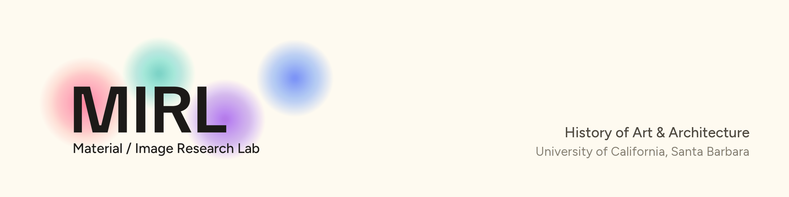

[Website](https://mirl.arthistory.ucsb.edu) ·
[Projects](https://mirl.arthistory.ucsb.edu/projects/) ·
[MIRL Tools](https://mirl.arthistory.ucsb.edu/mirl-tools/) ·
[Contact](mailto:mirl@arthistory.ucsb.edu)

MIRL, the Material / Image Research Lab, is the research and teaching lab of the
Department of History of Art & Architecture at UC Santa Barbara. We study the
relationship between art objects and their images: how objects are photographed,
scanned, digitized, and shared, and what is gained and lost when the material becomes
digital. Faculty bring their classes to the lab to work with objects up close, and we
build open tools for archives and cultural heritage, with students, artists,
communities, and partner institutions.

## MIRL Tools

Free, open instruments for finding, documenting, and defending cultural heritage, made
for the people who do this work one scholar, one community, or one collection at a time.
Each runs in the browser or on a laptop, installs nothing, and keeps data local, so that
control over the material, and protection of the people in the record, stays with them.
The tools share the same commitments: local-first and private, evidentiary discipline
with sha-256 fingerprints and provenance, open licensing, and documentation written for
non-coders. Each does one job on its own, and together they follow the arc of the work.

| | Tool | What it does | |
|---|------|--------------|---|
| **Find** | **MIRL Glean** | Searches twenty-two open museum, library, and archive collections at once, with every licence shown, Chicago citations, and downloads that record where each file came from. | [Open](https://mirl-ucsb.github.io/mirl-glean/) · [Repo](https://github.com/mirl-ucsb/mirl-glean) |
| **Secure** | **rescue-archiving** | Makes a verifiable, tamper-evident copy of at-risk online media, with a full chain of custody. | [Repo](https://github.com/mirl-ucsb/rescue-archiving) |
| **Catalogue what is gone** | **MIRL Lacuna** | A catalogue for archives that no longer exist: registers of destroyed, looted, and dispersed works, with consent-aware evidence and surviving copies in IIIF. | [Open](https://mirl-ucsb.github.io/mirl-lacuna/) · [Repo](https://github.com/mirl-ucsb/mirl-lacuna) |
| **Assess what stands** | **MIRL Aftermath** | Turns before-and-after photographs into a standardized condition dossier for damaged heritage. | [Open](https://mirl-ucsb.github.io/mirl-aftermath/) · [Repo](https://github.com/mirl-ucsb/mirl-aftermath) |
| **Read the object** | **MIRL 3D Analyzer** | A workbench for reading 3D scans of objects: measure, relight, slice, and map surface curvature. | [Open](https://mirl-ucsb.github.io/mirl-3d-analyzer/) · [Repo](https://github.com/mirl-ucsb/mirl-3d-analyzer) |

Further tools are in development, and will be added here as they are ready. More on the
[MIRL Tools page](https://mirl.arthistory.ucsb.edu/mirl-tools/).

## Research projects

**[California Native American Modern Art Archive](https://mirl.arthistory.ucsb.edu/cnamaa/)** (since 2023).
A post-custodial digital repository of modern and contemporary California Native art,
built with the artists, who keep control over how their work is represented, described,
and shared, under Indigenous data sovereignty principles.

**Eleven Days: A Counter-Archive of Mediterranean Santa Barbara** (since 2026, in development).
Eleven days after the 1925 earthquake, Santa Barbara's leadership resolved to rebuild the
city in a uniform Spanish style. The project reads that rebuilding as a forensic event,
building a counter-archive of what was made and what was suppressed, toward a public
exhibition. With María Lumbreras, María Minuesa Sicilia, and Alicia Boswell.

**Carol J. Mackey Archive** (2023; since 2026).
The working archive of archaeologist Carol J. Mackey, from her excavations at Farfán,
San José de Moro, and other Andean sites, brought into digital form by student
researchers. More than 2,100 items are published on JSTOR. Directed by Alicia Boswell.

**Ways of Seeing** (since 2026).
New three-dimensional ways of seeing objects, adapting techniques from scientific and
medical imaging so that 3D models become analytical instruments rather than
representations. Built on the [MIRL 3D Analyzer](https://github.com/mirl-ucsb/mirl-3d-analyzer).

**Color Film Emergency Project** (since 2025).
Preserving at-risk 35mm slide collections of architecture and cultural heritage with the
Society of Architectural Historians, funded by the National Endowment for the Humanities,
and publishing them through SAHARA on JSTOR.

**Documenting Ancient Americas Objects and Artworks** (since 2025).
Photography, cataloging, and provenance research for Ancient Americas works newly acquired
by UCSB's Art, Design & Architecture Museum.

**[Haptic Khipu](https://khipu.mirl.arthistory.ucsb.edu)** (2025 to 2026).
An interactive study of a 16th-century Andean khipu at the AD&A Museum, read cord by cord
through material analysis, tactile examination, and high-resolution imaging. Built with
Telar, the IIIF storytelling framework from UCSB's Archives, Memory, and Preservation Lab.
[Repo](https://github.com/mirl-ucsb/story)

**McConnel Fabulations** (2024).
Digitization of vernacular photographs and postcards from North Africa and Europe, 1920s
and 1930s.

## Work with us

- **Teaching with objects:** faculty can bring classes to MIRL and borrow from the AD&A
  Museum's collections. Email [mirl@arthistory.ucsb.edu](mailto:mirl@arthistory.ucsb.edu)
  at least four weeks before the quarter.
- **Internships:** undergraduates join our projects through ARTHI 192C. Contact Jeff
  O'Brien, Curator, at [jeffobrien@ucsb.edu](mailto:jeffobrien@ucsb.edu).
- **Room and equipment:** Christine Fritsch, Assistant Curator,
  [cfritsch@ucsb.edu](mailto:cfritsch@ucsb.edu).
- **Contributing to the tools:** see [CONTRIBUTING](https://github.com/mirl-ucsb/.github/blob/main/CONTRIBUTING.md)
  and our [Code of Conduct](https://github.com/mirl-ucsb/.github/blob/main/CODE_OF_CONDUCT.md).

Arts Building, Room 1245, UC Santa Barbara. Open Monday to Thursday, 8 am to 4 pm.
MIRL works on ancestral Chumash land.
